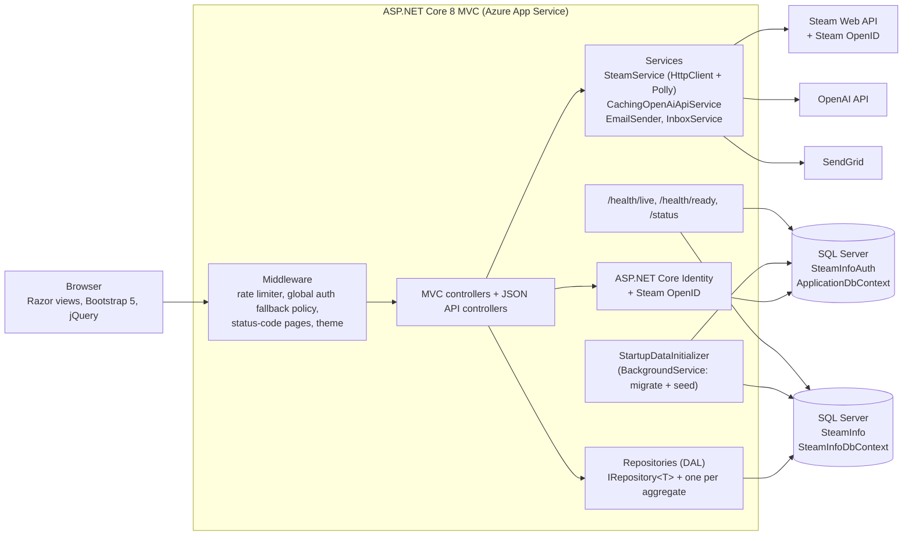

# SteamNexus


SteamNexus links a Steam account and shows your library, achievements and friends in one place. You can
start achievement competitions with your friends, read AI-summarised news for the games you follow, earn
badges and message friends in the app.

It began in 2023 as a university capstone built by a four-person team. Cole Woodard refactored it solo
after graduation (2025 to 2026). See [CONTRIBUTORS.md](CONTRIBUTORS.md).

- Live site: https://steamnexus.azurewebsites.net
- Contact: [portfolionexus.azurewebsites.net/Cole](https://portfolionexus.azurewebsites.net/Cole)
- Source: public mirror coming soon

## Features

- Steam sign-in (OpenID) or a local account linked to a Steam ID
- Dashboard with recently played and followed games and your current competitions, with a countdown
- Library with follow and hide, and per-game achievements
- Head-to-head and free-for-all achievement competitions, with re-match voting
- AI-summarised Steam news for the games you follow (OpenAI, cached on the server and rate limited per user)
- Badges awarded from your activity
- Friends list with block, unblock and remove
- In-app messaging with an unread badge and a best-effort email to the recipient (SendGrid). SMS is not implemented.
- Admin dashboard with ban and unban

## Architecture



The two databases are deliberate: Identity data and Steam/domain data live in separate SQL databases with
separate EF Core contexts. The reasons, and the other main decisions, are in [docs/adr](docs/adr).

| Path | What it is |
|---|---|
| `src/SteamProject` | The web app (controllers, views, DAL, services, migrations) |
| `src/NUnit_Tests` | Unit and integration tests (NUnit 4, Moq, `WebApplicationFactory`) |
| `src/BDD_Tests` | SpecFlow + Selenium scenarios from the capstone's user stories |
| `src/E2E_Tests` | Playwright end-to-end tests |
| `src/Javascript_Tests` | Jest tests for the front-end scripts |
| `docs/adr` | Architecture decision records |
| `course` | Capstone course deliverables: milestones, inception, sprint retrospectives |
| `nightshift` | The build/test gate scripts used during the solo refactor |

## My role (Cole Woodard)

> **Draft, to be confirmed.** These areas come from Cole's commits in `git log`. Teammates are credited by
> name once they agree to it.

**During the capstone (team, 2023)**

- The user dashboard: recently played and followed game carousels, and current and previous competitions with a countdown.
- AI-summarised game news: the OpenAI service, Steam news retrieval and the news pages.
- The badge system: badge tables, seeding badges from JSON, the award logic and the badge pop-up.
- The light/dark theme switcher, including its request middleware.
- Competition status and voting tables.
- SpecFlow + Selenium BDD tests (dashboard, linking and unlinking Steam, badges) and NUnit repository tests.

**After graduation (solo refactor, 2025 to 2026)**

- A security pass: a global authorization fallback policy, antiforgery on state-changing endpoints, and CSRF, IDOR and XSS fixes.
- Async all the way through the Steam API path, Polly retries with backoff (including HTTP 429) on the Steam HTTP client, and a server-side cache plus a per-user rate limit for OpenAI summaries.
- Null-safe Steam API parsing, covered by NUnit tests with fake HTTP handlers; test projects moved to NUnit 4.
- Features finished end to end: competition create and re-match voting backed by the database, friend block and unblock, admin unban, email on new messages.
- Migrations and seeding moved off the startup path into a background service, separate live and ready health checks, an anonymous build status page, and the public landing page.

## Run it locally

Prerequisites: .NET 8 SDK and a SQL Server you can reach (for example the `mcr.microsoft.com/mssql/server`
container on port 1433).

1. Set the secrets with [user-secrets](https://learn.microsoft.com/aspnet/core/security/app-secrets). Nothing
   secret is committed; `appsettings.json` holds placeholders only. The full list of keys is in
   [docs/SECRETS_MANAGEMENT.md](docs/SECRETS_MANAGEMENT.md).

   ```bash
   cd src/SteamProject
   dotnet user-secrets set "ConnectionStrings:SteamInfoConnection" "Server=localhost,1433;Database=SteamInfo;User Id=sa;Password=<yours>;TrustServerCertificate=true;MultipleActiveResultSets=true"
   dotnet user-secrets set "ConnectionStrings:SteamInfoAuthConnection" "Server=localhost,1433;Database=SteamInfoAuth;User Id=sa;Password=<yours>;TrustServerCertificate=true;MultipleActiveResultSets=true"
   dotnet user-secrets set "SteamKey" "<Steam Web API key>"
   dotnet user-secrets set "SeedUserPW" "<password for the seeded demo users>"
   dotnet user-secrets set "SeedAdminPW" "<password for the seeded admin>"
   ```

   `SendGridKey` is optional: without it, outgoing email is logged and skipped. `OpenAiKey` is needed only
   for the news summaries.

2. Run the app. It starts listening straight away; migrations and seeding run in the background
   (`Seeding:RunOnStartup`, default `true`).

   ```bash
   dotnet run --project src/SteamProject --launch-profile https   # https://localhost:7123
   ```

   The seed creates fictional users only: `demo.player@example.com`, `TestUser@mail.com`,
   `TestUser2@mail.com` and `admin@example.com`, with the passwords you set above.

3. Check it: `GET /health/live` returns 200 as soon as the process is up, `GET /health/ready` returns 200 once
   both databases answer, and `/status` shows the build and environment.

## Tests

```bash
dotnet test src/NUnit_Tests -c Release                 # unit + integration
cd src/Javascript_Tests && npm install && npm test     # Jest
cd src/E2E_Tests && npm install && npx playwright test # needs the app running
```

The BDD suite (`src/BDD_Tests`) starts the app itself and drives it with Selenium and headless Chrome.
It reads the seeded test user's password from user-secrets or the `SeedUserPW` environment variable,
and it fails, rather than skips, when the site it targets cannot be reached.

CI is GitHub Actions (`.github/workflows/SteamNexus.yml`): build, NUnit with Coverlet coverage and Jest on
every push and pull request; deploy to Azure App Service only on a push to `main` after those pass; then
the BDD suite against the deployed site. The coverage badge above is a committed file
(`docs/badges/coverage.svg`), regenerated with `scripts/update-coverage-badge.sh`; CI fails the run when it
no longer matches the measured coverage.
